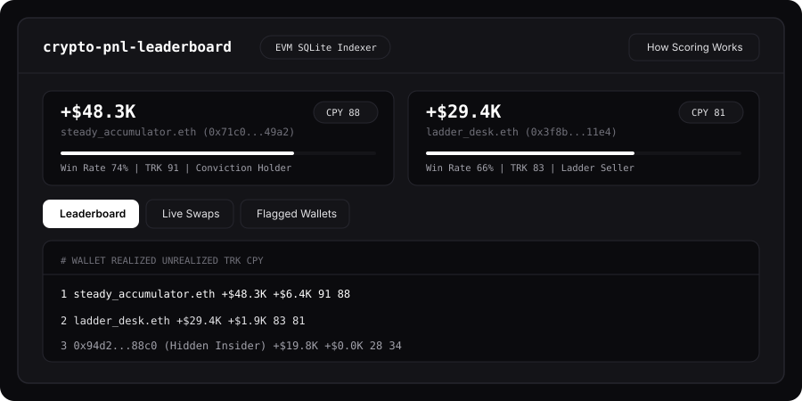

# crypto-pnl-leaderboard


Fast EVM wallet swap indexer and PnL leaderboard built with TypeScript and SQLite.

Most leaderboards rank loud bots at #1 just because they made 900 tiny trades in 10 seconds. I built this on 3am adrak chai to catch fake insiders and show real wallets that actually hold and win. When I wrote the scoring math only me and bhagwan knew how it worked, now mostly bhagwan knows, so I added clean unit tests for us mortals.



## What it does

- Indexes EVM wallet buys and sells into a fast local SQLite database.
- Calculates realized profit, open unrealized profit, win rate, and hold time.
- Gives every wallet two simple scores from 0 to 100 (`Track Score` and `Copy Score`).
- Flags shady wallets automatically (`Hidden Insider`, `Pump & Dump`, `Sniper`).
- Exports a tiny static `snapshot.json` file so you can host the UI anywhere for free.

## Run it in 60 seconds

```bash
git clone https://github.com/LevCodeLab/crypto-pnl-leaderboard.git
cd crypto-pnl-leaderboard
npm install

# Run unit tests and TypeScript check
npm test
npm run typecheck

# Start local server with sample EVM swaps on http://localhost:3000
npm start
```

Want a static JSON file for free static hosting? Run one command:

```bash
npm run snapshot
```

## Which file to edit

| File | What to change here |
| :--- | :--- |
| `server/scorer.ts` | Change PnL math, win rate weights, or insider penalty rules |
| `server/swapSource.ts` | Plug in your own EVM swap API URL or edit sample wallets |
| `server/indexer.ts` | Edit how swaps are saved and pruned in SQLite |
| `server/db.ts` | Edit SQLite tables and indexes |
| `public/app.js` | Edit leaderboard columns, sorting buttons, and wallet popup |
| `public/style.css` | Edit dark monochrome colors and layout |

## License

MIT License. Clone it, break it, ship it.
